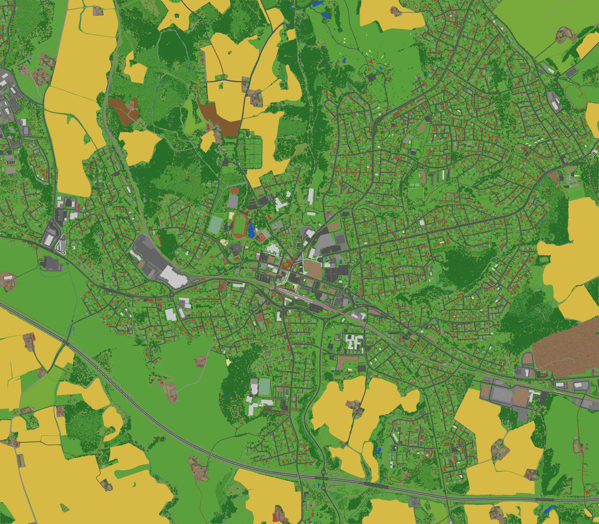
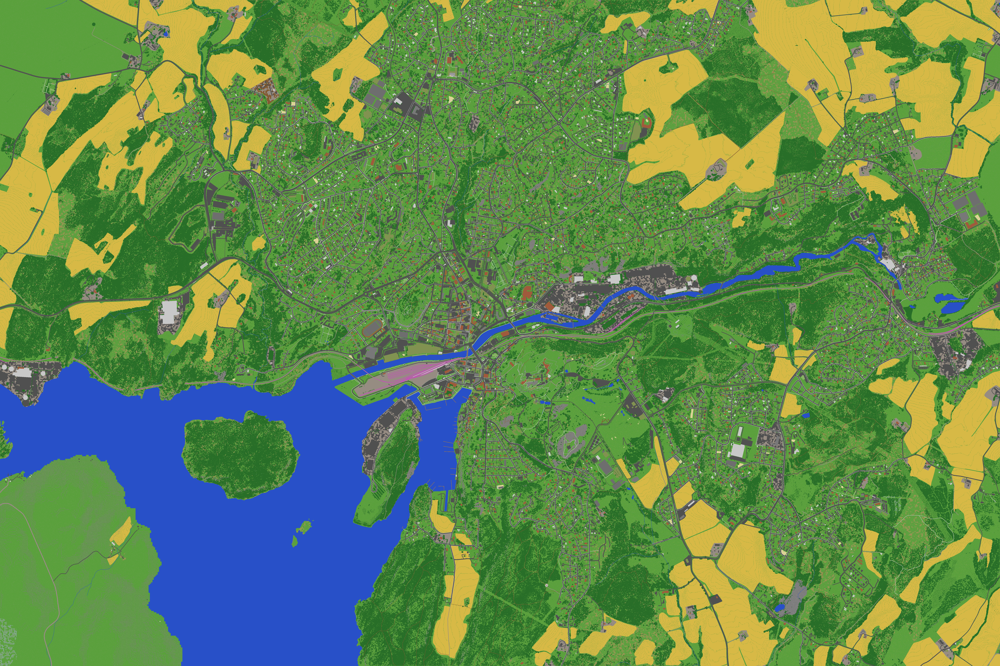
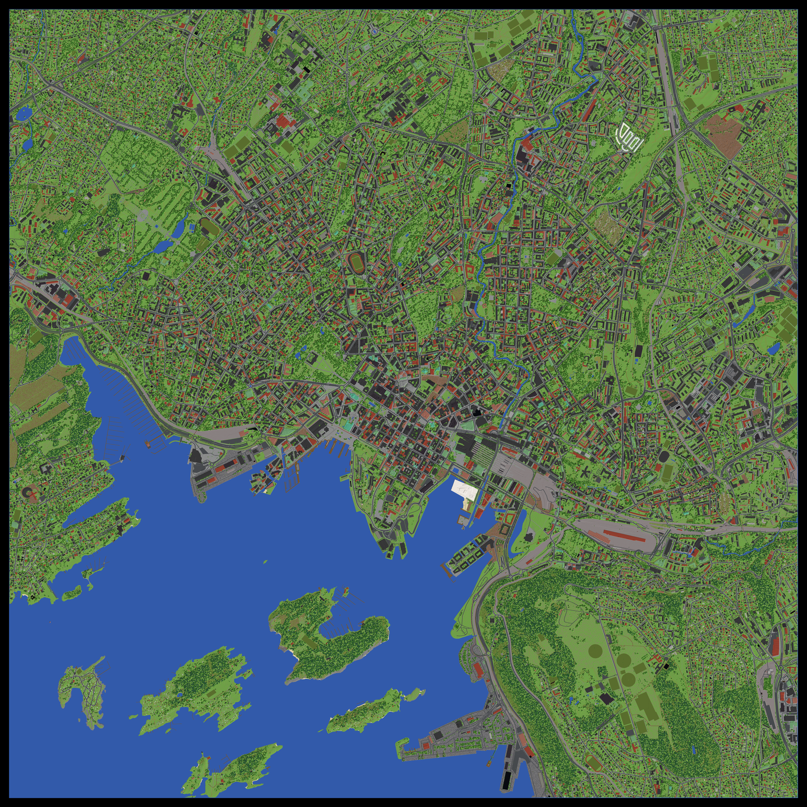

# Norske byer i Minecraft

Minecraft-kart av norske byer i skala 1:1. Planen er å fylle på med flere byer etter hvert.

Kartene er laget for Minecraft Java Edition 1.21.11.

## Askim

Du starter på Askim torg, rett ved jernbanestasjonen.

### Teleportering i Askim

Vis alle 32 TP-kommandoer for Askim

**Sentrum**

| Sted | Kommando |
|---|---|
| Askim torg (startpunkt) | `/tp @s -32 62 412` |
| Askim stasjon | `/tp @s 2 62 532` |
| Jernbaneparken | `/tp @s -133 61 461` |
| Askimtorget (kjøpesenter) | `/tp @s 69 62 314` |
| Indre Østfold rådhus | `/tp @s -178 64 181` |
| Askim bibliotek | `/tp @s -154 64 194` |
| Askim kino | `/tp @s -207 64 178` |
| Askim kulturhus | `/tp @s 199 64 265` |
| Østfoldbadet | `/tp @s 228 65 228` |
| Kulturparken / Badeparken | `/tp @s 181 64 240` |
| Guderudparken | `/tp @s -61 63 420` |
| Kittaparken | `/tp @s 316 64 421` |
| Falt for Norge (minnesmerke) | `/tp @s 61 62 316` |

**Parker, kirker og museum**

| Sted | Kommando |
|---|---|
| Folkeparken | `/tp @s -312 74 -8` |
| Parkdammen | `/tp @s -309 72 46` |
| Fylkessykehusets park | `/tp @s -202 77 -104` |
| Askimhallen | `/tp @s -438 83 -151` |
| Askim kirke | `/tp @s -514 82 -503` |
| Mariakirken | `/tp @s 769 75 766` |
| Askim museum | `/tp @s 622 89 -609` |
| Vakttårnet | `/tp @s 599 89 -636` |

**Skoler og boligområder**

| Sted | Kommando |
|---|---|
| Askim videregående skole | `/tp @s -220 52 1179` |
| Askim ungdomsskole | `/tp @s 316 68 968` |
| Askimbyen skole | `/tp @s -465 65 160` |
| Grøtvedt skole | `/tp @s 811 76 -295` |
| Korsgård skole | `/tp @s 1871 94 -292` |
| Moen skole | `/tp @s 75 50 1936` |
| Askim hundepark | `/tp @s 1676 87 240` |
| Sprett aktivitetspark | `/tp @s 1531 80 1123` |
| Gurud | `/tp @s -1235 35 469` |
| Østre Moen | `/tp @s -40 59 1152` |
| Blunkeslett | `/tp @s 789 79 -586` |

Koordinater fra et vanlig kart: `x = (lengdegrad − 11,167) × 56 360 + 169` og `z = (59,58325 − breddegrad) × 110 574 + 318`. Dette treffer innenfor noen få blokker.

## Halden

Du starter midt i sentrum, ved Storgata og rådhuset.

### Teleportering i Halden

Vis alle 63 TP-kommandoer for Halden

**Sentrum og havna**

| Sted | Kommando |
|---|---|
| Halden stasjon | `/tp @s -224 65 281` |
| Torget | `/tp @s 19 65 359` |
| Gjestehavna / Brygga | `/tp @s -17 65 402` |
| Garntorget | `/tp @s 49 67 230` |
| Storgata (gågata) | `/tp @s 20 68 8` |
| Immanuels kirke | `/tp @s 209 71 162` |
| Halden rådhus | `/tp @s -11 68 -9` |
| Fredrikshalds Teater | `/tp @s -115 67 -92` |
| Kulturhuset i Halden | `/tp @s -119 66 -55` |
| Halden bibliotek | `/tp @s 104 74 -294` |
| Halden kino | `/tp @s 150 70 -313` |
| St. Peter kirke | `/tp @s 73 74 -280` |
| Busterudparken | `/tp @s 78 73 -172` |
| Tista-senter | `/tp @s -329 65 157` |
| Grand Hotell | `/tp @s -103 66 239` |
| Thon Hotel Halden | `/tp @s -54 65 419` |
| Sauøya | `/tp @s -512 105 936` |
| Chr. Sindings plass | `/tp @s 159 83 -660` |

**Fredriksten festning**

| Sted | Kommando |
|---|---|
| Fredriksten festning | `/tp @s 522 158 337` |
| Hovedvakten | `/tp @s 549 161 339` |
| Dronningens kruttårn | `/tp @s 479 151 299` |
| Klokketårnet | `/tp @s 519 168 435` |
| Donjonen | `/tp @s 586 161 184` |
| Ravelinporten | `/tp @s 631 167 349` |
| Minnesmerke over Karl XII | `/tp @s 880 157 243` |
| Gyldenløve | `/tp @s 1042 161 255` |
| Overberget | `/tp @s 806 184 887` |
| Stortårnet | `/tp @s 697 165 634` |
| Fredriksten hotell | `/tp @s 385 150 747` |

**Vest og nord**

| Sted | Kommando |
|---|---|
| Rød herregård | `/tp @s -1032 99 -84` |
| Rødsparken | `/tp @s -1157 85 73` |
| Halden stadion | `/tp @s -727 73 -50` |
| Rødsberget | `/tp @s -432 103 -232` |
| Solbakkparken | `/tp @s -250 84 -411` |
| Halden sykehus | `/tp @s -578 135 -771` |
| Høgskolen i Østfold (Remmen) | `/tp @s -1861 121 -861` |
| Remmen | `/tp @s -1927 119 -956` |
| Låby | `/tp @s -1061 129 -775` |
| Karrestad | `/tp @s -1243 150 -1434` |
| Strupe | `/tp @s -758 148 -1952` |
| Brødløs | `/tp @s -229 140 -1905` |
| Hjortsberghallen | `/tp @s -152 145 -2097` |
| Halden ishall | `/tp @s 1287 173 -1487` |
| Gimle | `/tp @s 1084 169 -1866` |
| Schultzedalen | `/tp @s -11 99 -1200` |
| Os kapell | `/tp @s 295 84 -563` |
| Nexans arena | `/tp @s 68 75 -526` |
| Berg kirke | `/tp @s -3179 142 -1875` |
| Nexanstårnet | `/tp @s -3278 69 261` |
| Refne | `/tp @s -1577 64 246` |
| Høvleriet | `/tp @s -851 66 193` |

**Øst og sør**

| Sted | Kommando |
|---|---|
| Tistedal | `/tp @s 3325 144 -234` |
| Tistedal kirke | `/tp @s 3327 136 -563` |
| Tistedalen brygge | `/tp @s 3623 143 -123` |
| Tistedalen stadion | `/tp @s 3867 148 -989` |
| Kaken | `/tp @s 1018 76 -370` |
| Os skole | `/tp @s 856 157 1178` |
| Knardal | `/tp @s 331 107 963` |
| Eskeviken | `/tp @s -72 68 1541` |
| Slavekirkegården | `/tp @s 465 185 1471` |
| Brattøya | `/tp @s -1760 130 921` |
| Hollenderen | `/tp @s -1488 64 477` |
| Asak kirke | `/tp @s 4000 167 -2187` |

Koordinater fra et vanlig kart: kartet bruker UTM sone 33 (EUREF89), så `x = øst − 293 228` og `z = 6 559 302 − nord`. Østlige og nordlige koordinater finner du for eksempel på norgeskart.no.

## Oslo

Sentrale Oslo, 7 × 7 km, fra Frogner og Majorstuen i vest til Ekeberg og Bryn i øst. Terrenget kommer fra Kartverkets høydemodell (1 m oppløsning). Bygninger, veier, parker og trær er laget fra OpenStreetMap, og byggehøyder og tretopper fra Kartverkets overflatemodell. Du starter i sentrum.

### Teleportering i Oslo

Vis alle 80 TP-kommandoer for Oslo

**Sentrum**

| Sted | Kommando |
|---|---|
| Oslo S | `/tp @s 617 60 397` |
| Jernbanetorget | `/tp @s 520 53 243` |
| Byporten / Oslo City | `/tp @s 537 56 319` |
| Oslo bussterminal | `/tp @s 900 52 305` |
| Oslo domkirke | `/tp @s 240 60 196` |
| Stortorvet | `/tp @s 180 60 147` |
| Stortinget | `/tp @s 70 63 66` |
| Eidsvolls plass | `/tp @s -181 58 72` |
| Spikersuppa | `/tp @s -284 56 17` |
| Grand Hotel | `/tp @s -151 58 33` |
| Studenterlunden | `/tp @s -428 57 -86` |
| Nationaltheatret | `/tp @s -548 65 -214` |
| Det Norske Teatret | `/tp @s -183 60 -146` |
| Det kongelige slott | `/tp @s -810 84 -400` |
| Slottsparken | `/tp @s -728 83 -442` |
| Karl Johan-monumentet (Slottsplassen) | `/tp @s -696 78 -354` |
| Hammersborg | `/tp @s 267 79 -470` |
| Oslo Spektrum | `/tp @s 695 77 167` |

**Havna og Kvadraturen**

| Sted | Kommando |
|---|---|
| Oslo rådhus | `/tp @s -459 53 210` |
| Rådhusplassen | `/tp @s -534 51 285` |
| Nobels Fredssenter | `/tp @s -663 52 232` |
| Nasjonalmuseet | `/tp @s -747 52 246` |
| Aker Brygge | `/tp @s -826 52 345` |
| Tjuvholmen | `/tp @s -1181 50 630` |
| Astrup Fearnley Museet | `/tp @s -1174 52 743` |
| Akershus slott | `/tp @s -418 52 810` |
| Akershus festning | `/tp @s -307 56 872` |
| Kontraskjæret | `/tp @s -342 59 409` |
| Christiania torv | `/tp @s -168 57 416` |
| Bankplassen | `/tp @s -73 54 581` |
| Vippetangen | `/tp @s -159 50 1357` |

**Bjørvika og Gamlebyen**

| Sted | Kommando |
|---|---|
| Operahuset | `/tp @s 534 65 750` |
| Deichman Bjørvika | `/tp @s 557 52 615` |
| Munchmuseet | `/tp @s 647 52 965` |
| Barcode | `/tp @s 925 54 726` |
| Sukkerbiten | `/tp @s 532 51 1040` |
| Sørenga | `/tp @s 843 52 1243` |
| Middelalderparken | `/tp @s 1143 55 1175` |
| Gamlebyen | `/tp @s 1478 63 1181` |
| Ekebergparken | `/tp @s 844 104 1783` |
| Ekeberg (Skrik-utsikten) | `/tp @s 1341 117 1516` |
| Sjømannsskolen | `/tp @s 769 108 1890` |
| Hovedøya (fergekai) | `/tp @s -751 50 1634` |
| Hovedøya kloster | `/tp @s -895 64 1925` |

**Øst**

| Sted | Kommando |
|---|---|
| Grønland | `/tp @s 1103 52 244` |
| Tøyen | `/tp @s 1516 68 -209` |
| Botanisk hage | `/tp @s 1572 82 -377` |
| Tøyenparken | `/tp @s 2072 94 -528` |
| Tøyenbadet | `/tp @s 2059 99 -472` |
| Kampen | `/tp @s 2119 102 293` |
| Vålerenga kirke | `/tp @s 2501 103 1001` |
| Galgeberg | `/tp @s 2001 83 896` |
| Ensjø | `/tp @s 2587 104 131` |
| Helsfyr | `/tp @s 3364 132 234` |
| Gamle Munch | `/tp @s 1815 77 -190` |

**Nord**

| Sted | Kommando |
|---|---|
| Vulkan | `/tp @s 602 55 -926` |
| Schous plass | `/tp @s 1056 62 -657` |
| Olaf Ryes plass (Grünerløkka) | `/tp @s 958 68 -909` |
| Birkelunden | `/tp @s 1092 79 -1300` |
| Sofienbergparken | `/tp @s 1294 70 -927` |
| Carl Berner | `/tp @s 1973 98 -1218` |
| Torshovparken | `/tp @s 1768 131 -2241` |
| Sagene | `/tp @s 894 119 -2485` |
| Ila | `/tp @s 543 82 -1818` |
| Gamle Aker kirke | `/tp @s 348 98 -1064` |
| St. Hanshaugen | `/tp @s -40 115 -1332` |
| Bislett stadion | `/tp @s -416 86 -1243` |
| Lindern | `/tp @s -91 122 -2299` |
| Universitetet i Oslo (Blindern) | `/tp @s -826 108 -1967` |

**Vest**

| Sted | Kommando |
|---|---|
| Uranienborg kirke | `/tp @s -1206 99 -847` |
| Frogner | `/tp @s -1924 87 -1033` |
| Frognerparken / Vigelandsparken | `/tp @s -2170 85 -1545` |
| Fontenen i Vigelandsanlegget | `/tp @s -2183 86 -1564` |
| Vigelandmuseet | `/tp @s -2260 83 -1122` |
| Frognerbadet | `/tp @s -1864 91 -1599` |
| Majorstuen | `/tp @s -1374 98 -1783` |
| Colosseum kino | `/tp @s -1645 95 -1824` |
| Framneshaven | `/tp @s -1786 56 164` |
| Skøyen | `/tp @s -3057 74 -1386` |
| Bygdøynes (Fram og Kon-Tiki) | `/tp @s -2463 52 1025` |

Koordinater fra et vanlig kart: kartet bruker UTM sone 33 (EUREF89), så `x = øst − 262 000` og `z = 6 649 500 − nord`. Havnivået ligger på y = 48.

## Slik bruker du et kart

1. Last ned repoet (Code → Download ZIP) eller klon det.
2. Kopier mappen til byen du vil spille, for eksempel `Askim`, inn i `saves`-mappen:
   - Windows: `%APPDATA%\.minecraft\saves`
   - macOS: `~/Library/Application Support/minecraft/saves`
   - Linux: `~/.minecraft/saves`
3. Start Minecraft – byen dukker opp i listen over verdener.

## Slik teleporterer du

Alle tre kartene har juks (cheats) slått på og starter i kreativ modus, så du kan bruke `/tp` med en gang.

1. Trykk `T` (eller `/`) for å åpne chatten.
2. Lim inn en kommando fra listene over, for eksempel `/tp @s 19 65 359`, og trykk Enter.

Alle punktene er hentet fra selve kartfilene. De ligger på bakken, på en plass eller ved inngangen, aldri i vann eller inni en vegg, så du lander trygt.

Nyttige ting å vite:

- Tallene er `x y z`. **x** går mot øst, **z** går mot sør, og **y** er høyden. 1 blokk er 1 meter.
- Trykk `F3` for å se hvor du står. Koordinatene står ved «XYZ».
- `/tp @s ~ ~50 ~` flytter deg 50 blokker rett opp. Det er fint for å se byen ovenfra.
- `/tp @s 100 ~ -200` flytter deg til x = 100, z = −200 og beholder høyden. Hvis du havner inni noe, kan du skrive `/tp @s ~ ~10 ~`.
- `/gamemode spectator` lar deg fly gjennom vegger og tak. `/gamemode creative` tar deg tilbake.
- `/spawnpoint` gjør stedet der du står til ditt nye startpunkt.
- Spiller du med andre, kan du teleportere til en venn med `/tp @s <navn>`, eller hente alle til deg med `/tp @a @s`.
- Hvis du har slått av juks i en verden, kan du slå det på for økten med Esc → Open to LAN → Allow Cheats: ON.
